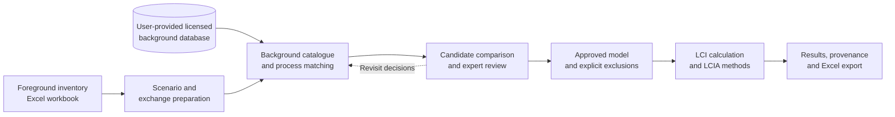

# FlexPOL-LCA

### A modular platform for flexible, transparent, and expert-guided Life Cycle Assessment

**FlexPOL-LCA** is a Python-based scientific software platform designed to support the preparation, modeling, calculation, and interpretation of Life Cycle Assessment (LCA) studies. It brings foreground inventory management, background-process matching, expert review, Life Cycle Impact Assessment (LCIA), and results reporting into one connected workflow.

The platform is intended for researchers, LCA practitioners, and organizations that need to assess product systems while retaining visibility into the assumptions, data connections, and decisions underlying their results. Rather than treating matching and calculation as disconnected tasks, FlexPOL-LCA helps users move from an Excel-based foreground inventory to a traceable assessment supported by their own compatible background databases.

> **Platform availability and database licensing:** FlexPOL-LCA is being prepared for distribution as a packaged executable application. The planned distributed package will **not include the Python source code or commercial/restricted background databases**. The platform is designed to work with supported **ecoinvent** and **Environmental Footprint (EF)** background datasets when users have the necessary licenses, access rights, and compatible database files. Database licenses and access are the responsibility of the user; availability and compatibility may depend on the database release and supplied format.

## Why FlexPOL-LCA?

Building an LCA model often involves several demanding tasks: organizing foreground exchanges, finding appropriate background providers, checking reference products and units, documenting modeling choices, resolving ambiguous or missing matches, and translating an inventory into impact results. When these activities are performed across separate spreadsheets and tools, the resulting workflow can be difficult to repeat and audit.

FlexPOL-LCA addresses this practical challenge through a guided, modular environment. It aims to reduce repetitive data-handling work **without replacing scientific judgment**. Users remain responsible for choosing defensible background processes, reviewing unresolved exchanges, defining system boundaries, interpreting exclusions, and assessing the validity of calculated results.

## How the platform works

The workflow follows six connected stages:

1. **Inventory preparation.** Users import an Excel foreground inventory containing process activities, material and energy requirements, wastes, emissions, amounts, and units. The platform structures these entries into scenarios and individual exchanges for further assessment.
2. **Background database selection.** Users select a compatible database package that they are entitled to use. The platform can utilize supported ecoinvent and EF datasets as sources of background activities, products, flows, and environmental information.
3. **Automated candidate matching.** Foreground exchanges are compared with background candidates using process/product descriptions and relevant scientific constraints, including flow identity, units, roles, and geographic information where available. Candidate retrieval and ranking support the expert; they do not constitute automatic scientific approval.
4. **Expert review and scenario refinement.** Users inspect suggested candidates and approve, reject, or leave decisions unresolved. Decisions are tracked at exchange level. Where supported by the workflow, unresolved or rejected exchanges may be explicitly excluded from a reduced-scope calculation rather than silently ignored.
5. **Life cycle calculation.** The platform constructs the modeled demand from approved exchanges, uses the selected background system to calculate the life cycle inventory, and applies available compatible LCIA methods and characterization factors subject to scientific validation.
6. **Results and reporting.** Users review scenario-level results, calculation status, exclusions, and supporting information, and export structured outputs for further analysis and documentation.

## Main capabilities

### Structured foreground inventory and scenarios

FlexPOL-LCA accepts spreadsheet-based foreground information and organizes it into scenario-specific modeling contexts. This supports assessments involving multiple unit processes or alternative scenarios while maintaining the identities, amounts, units, and source locations of individual exchanges. The platform is designed to make the link between the original inventory and the modeled assessment easier to inspect.

### Background integration without bundled databases

The platform separates its calculation and matching functionality from the background datasets supplied by users. Its architecture supports compatible **ecoinvent** and **EF** database packages, enabling practitioners to work with datasets they are independently authorized to access. FlexPOL-LCA is **not a distributor of ecoinvent or EF data**, and possession of the software does not confer a database license. Import compatibility, available processes, LCIA methods, and coverage depend on the actual database package and its format.

### Candidate matching with expert control

Automated retrieval and ranking help users locate plausible background activities for foreground requirements. The review stage exposes candidate choices so that practitioners can assess reference-product suitability, process roles, units, geography, and other modeling considerations. Decisions remain exchange-specific, allowing repeated materials or electricity requirements to be reviewed independently when necessary.

### Transparent treatment of unresolved exchanges

Real inventories do not always map cleanly to a background database. FlexPOL-LCA distinguishes approved exchanges from those that are rejected or remain unresolved. A reduced-scope scenario can proceed with explicitly documented exclusions when the applicable workflow and validation conditions permit it. Such results must be interpreted as **partial assessments of the approved modeled scope**, not automatically as complete LCAs of the original inventory.

### Native LCI and LCIA execution

FlexPOL-LCA includes a native calculation workflow for connecting approved foreground demand to an imported background system and applying selected LCIA methods. It supports method selection, compatibility checks, characterization, and structured result generation. Calculation readiness and method coverage must be evaluated for the selected model and indicator; the presence of a method library alone does not guarantee complete characterization of every inventory flow.

### Reproducibility and reporting

The platform is designed to retain the context of matching and expert decisions, identify exclusions, and produce structured Excel results. This supports subsequent review and comparison of modeling choices. Scientific reproducibility still depends on preserving the foreground inventory, database version, selected methods, model settings, and relevant exported evidence.

## Platform interface

The application provides a guided interface organized around the main LCA stages, including **Home, Inventory, Matching, Review, LCIA Method, and Results**. Users can follow the assessment from initial data preparation through expert decisions to calculation and reporting without operating individual backend scripts.

### Figure 1 — Foreground inventory, matching, and expert review

*Suggested screenshot: the Matching or Review page showing foreground exchanges and candidate background activities. Replace this placeholder with an actual platform screenshot.*

### Figure 2 — LCIA methods and results

*Suggested screenshot: the LCIA Method or Results page showing selected impact indicators and calculated outputs. Replace this placeholder with an actual platform screenshot.*

## What users should expect

| Capability | Current scope and expectation |
|---|---|
| Foreground input | Excel-based foreground inventory preparation and scenario handling |
| Background data | Compatible user-supplied ecoinvent and EF packages, subject to licensing and format compatibility |
| Matching | Automated candidate identification and ranking, followed by expert review |
| Decisions | Exchange-specific approvals, rejections, and unresolved states |
| Exclusions | Explicit reduced-scope treatment where permitted; exclusions remain visible in reporting |
| Calculation | Native inventory and impact calculation using supported database packages and LCIA methods |
| Outputs | Structured results and Excel exports with relevant decision and exclusion context |
| Scientific responsibility | Users must validate system boundaries, provider selections, data suitability, method coverage, and interpretation |

**Current validation status.** Development testing has demonstrated execution of selected EF and ecoinvent workflows, including a successful ecoinvent 3.12 consequential calculation for a reduced-scope scenario. These demonstrations establish functional capability for the tested cases, **not universal compatibility or numerical equivalence across all database releases, models, and LCIA methods**. Independent reference-software comparisons and broader scientific validation remain important.

## Current boundaries and limitations

FlexPOL-LCA is a research-oriented platform, not an automatic substitute for a qualified LCA practitioner. Background availability is constrained by the user's licensed database content; some foreground flows may have no suitable provider. Automated candidate ranking does not establish scientific appropriateness on its own. Excluding exchanges changes the modeled system boundary and may materially affect results. LCIA results depend on method metadata, characterization-factor coverage, database consistency, and correct foreground modeling. Users should therefore document and review assumptions before using outputs in publications, comparative assertions, or decision-making.

## Development roadmap

The platform's modular design allows additional research and analytical capabilities to be developed without changing its fundamental expert-guided approach. **The following are intended directions, not promises of features already available:**

- **Prospective and policy-oriented LCA:** improved handling of future scenarios, changing background assumptions, and policy-relevant comparisons.
- **Sensitivity and uncertainty analysis:** systematic variation of influential inputs, assumptions, and modeling choices, with clearer interpretation of result robustness.
- **Safe and Sustainable by Design (SSbD):** additional assessment, scoring, and decision-support layers when their scientific methodologies are established.
- **Enhanced evidence and provenance:** stronger traceability of background choices, exclusions, method compatibility, and reproducible assessment records.
- **Advanced matching assistance:** further research into semantic retrieval and constraint-aware decision support while retaining expert approval.
- **Broader scientific validation:** more extensive comparisons with established LCA tools, additional databases and indicators, and documented benchmark cases.

## Distribution and access

FlexPOL-LCA is being developed for distribution as an **executable software application**. The planned public/user-facing release will provide access to application functionality **without distributing the underlying Python source code**. The package will **not contain ecoinvent, EF, or other third-party background databases**. Users will need to obtain their own valid licenses and provide compatible datasets in accordance with the relevant providers' terms. Packaging, platform availability, and access conditions will be communicated with the release.

For inquiries about research collaboration, availability, or beta access, contact **mhna@igt.sdu.dk** or **bekh@igt.sdu.dk**.

## Project team and acknowledgement

**Collaborators:** Mohammadhossein Narang, Hadis Marami, and Benyamin Khoshnevisan.

This work has received funding from the European Union's Horizon Europe Research and Innovation programme through **AGRO4AGRI (Grant Agreement No. 101130890)**. The views and methodologies expressed are those of the authors and do not necessarily reflect those of the European Union or the granting authority. Neither the European Union nor the granting authority can be held responsible for them.

**Project website:** https://agro4agri.eu/
