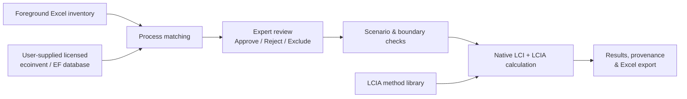
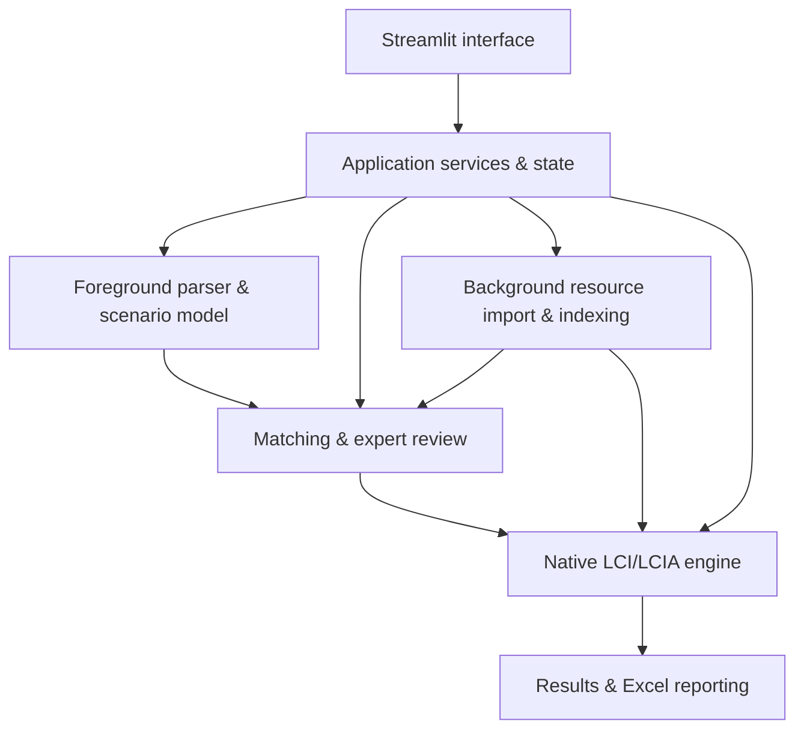

# FlexPOL-LCA
### Flexible, Prospective, and Policy-Oriented Life Cycle Assessment

**FlexPOL-LCA** is a modular, Python-based platform that connects foreground life cycle inventories to licensed background LCI databases, supports expert-reviewed process matching, and performs life cycle impact assessment (LCIA) through a guided graphical interface.

Designed for transparent and reproducible LCA, it integrates inventory preparation, candidate matching, scientific review, scenario handling, calculation, and results export in one workflow.

> **Distribution and database licensing:** The planned user release will provide a packaged executable application, **not the Python source code or any background databases**. FlexPOL-LCA is designed to work with **ecoinvent** and **Environmental Footprint (EF)** background databases when users independently hold the necessary licenses or access rights and supply compatible database files. **No ecoinvent or EF data is bundled, sublicensed, or distributed with FlexPOL-LCA.** Database access, permitted formats, and use remain subject to each provider's licensing terms.

## At a glance

| | |
|---|---|
| **Purpose** | Guided, expert-controlled LCI/LCIA workflows |
| **Interface** | Browser-based graphical application (Streamlit) |
| **Foreground input** | Structured Excel inventories and scenarios |
| **Background databases** | User-supplied, appropriately licensed **ecoinvent** and **EF** datasets in supported import formats |
| **Core functions** | Matching, expert review, scenario management, native calculation, LCIA methods, exports |
| **Distribution plan** | Executable application; source code and databases excluded |
| **Development** | University of Southern Denmark (SDU), Life Cycle Engineering |

## How FlexPOL-LCA works

The platform keeps the analyst in control of background-provider selection. Candidate matches are evaluated using process and reference-product information, units, geography, and other available metadata. Experts can inspect candidates and make explicit decisions before calculation. Unresolved or excluded exchanges remain identifiable in the assessment outputs.

## Main capabilities

| Capability | Description |
|---|---|
| **Foreground inventory** | Import Excel-based scenarios, unit processes, material and energy inputs, waste flows, and direct emissions. |
| **Background integration** | Import and use supported formats of **ecoinvent** and **EF** datasets supplied by authorized users. |
| **Automated matching** | Generate and rank candidate background processes using available flow, product, unit, and contextual information. |
| **Expert-in-the-loop review** | Approve or reject candidate links, preserve exchange-level decisions, and identify unresolved items. |
| **Scenario handling** | Manage calculation-ready scenarios and explicitly documented reduced-scope exclusions. |
| **Native LCI/LCIA** | Construct background-linked inventory calculations and apply compatible LCIA method libraries. |
| **Results and traceability** | Inspect calculated impacts, selected methods, approved links, exclusions, and export results to Excel. |

## Platform interface

The application guides users through **Home → Inventory → Matching → Review → LCIA Method → Results**. Database preparation and resource management are handled through the platform's supported data-management workflow.

<!-- SCREENSHOT 1: Save a screenshot of the Home/Inventory or Matching page as docs/images/flexpol-workflow.png -->

*Figure 1. Suggested screenshot: foreground inventory, selected background database, or matching candidates.*

<!-- SCREENSHOT 2: Save a screenshot of the LCIA Method or Results page as docs/images/flexpol-results.png -->

*Figure 2. Suggested screenshot: LCIA method selection, calculation status, or exported impact results.*

> **Before publishing:** Replace both image paths with actual screenshots. These are placeholders; the image files are not included in this README.

## Modular architecture

The separation between the interface, inventory parsing, background resources, matching, review decisions, and calculation engine supports maintainability and scientific traceability. Background database contents remain distinct from the application itself.

## Background database support and licensing

FlexPOL-LCA is **database-enabled, not database-bundled**. It can utilize supported **ecoinvent** and **Environmental Footprint (EF)** background inventory resources when the user obtains the datasets through an authorized channel and has the applicable license or access rights.

- **ecoinvent:** Support for importing and calculating with compatible ecoinvent inventory packages, including an evaluated ecoinvent 3.12 consequential workflow.
- **Environmental Footprint (EF):** Support for compatible EF datasets and associated inventory workflows, including evaluated EF 3.1 workflows.
- **LCIA methods:** Availability and compatibility depend on the supplied method library, its metadata, the imported database, and the selected impact categories.

Database availability is **not** guaranteed by purchasing or receiving FlexPOL-LCA. Users are responsible for obtaining and lawfully using their own datasets. Import compatibility should be confirmed for the specific database version, system model, and export format.

## Scientific transparency

FlexPOL-LCA distinguishes **automated candidate suggestions** from **expert-approved background links**. It retains information about selected exchanges and exclusions so that a reduced-scope result is not mistaken for a complete product-system assessment. Calculation readiness, characterization coverage, and numerical validity are separate considerations.

For example, an internal ecoinvent 3.12 test calculated **0.6959343369 kg CO₂-Eq** for a reduced-scope scenario containing an approved **2 kg phosphoric-acid exchange**. The other 14 exchanges in that scenario were excluded. This demonstrates an executed workflow; it is **not** a general validation claim or a representative environmental impact factor for phosphoric acid.

## Distribution and access

The intended distribution model is a **packaged executable application** for authorized users. The distributed package is planned to exclude both the project's Python source code and third-party background database files. Users will provide their own licensed datasets and compatible method resources where required.

Packaging and access-control details will be communicated with the release. An executable-only distribution should not be interpreted as a guarantee that implementation details cannot be reverse engineered.

**Beta access / enquiries:** [mhna@igt.sdu.dk](mailto:mhna@igt.sdu.dk) · [bekh@igt.sdu.dk](mailto:bekh@igt.sdu.dk)

**Collaborators:** Mohammadhossein Narang, Hadis Marami, Benyamin Khoshnevisan.

## Research and acknowledgements

FlexPOL-LCA has been developed in the context of Life Cycle Engineering research at the **University of Southern Denmark (SDU)**. The original project description acknowledges support from the European Union's Horizon Europe research and innovation programme through **AGRO4AGRI (Grant Agreement No. 101130890)**.

Funded by the European Union. Views and opinions expressed are those of the authors only and do not necessarily reflect those of the European Union or the granting authority. Neither the European Union nor the granting authority can be held responsible for them.

[AGRO4AGRI project website](https://agro4agri.eu/)

---

*FlexPOL-LCA — modular, transparent, expert-controlled life cycle assessment.*
