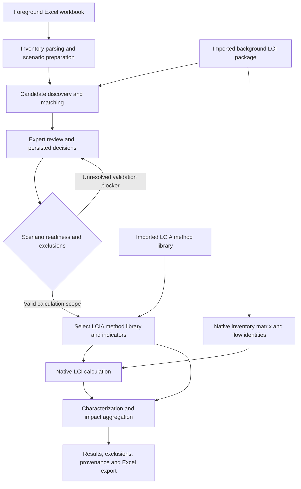
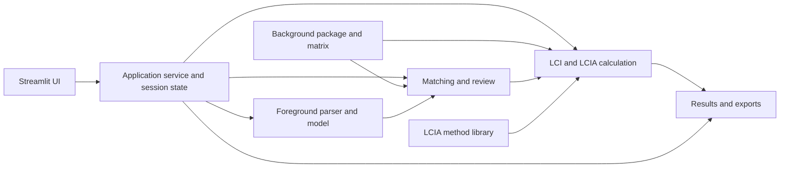

# FlexPOL-LCA

## A modular Python platform for Flexible, Prospective, and Policy-Oriented Life Cycle Assessment

**FlexPOL-LCA** is a Python-based, modular software platform for preparing foreground life cycle inventories, connecting them to background life cycle inventory (LCI) databases, reviewing and approving background-process matches, and calculating and reporting life cycle impact assessment (LCIA) results. It provides a guided, browser-accessible graphical interface powered by Streamlit, while keeping inventory processing, matching, database integration, calculation, and reporting in separable backend components.

FlexPOL-LCA is developed as research software to support transparent, reproducible, expert-controlled LCA workflows. Its emphasis is not merely automating database lookups: the platform preserves the relationship between each foreground exchange, the candidate background processes, the analyst's decision, the calculation boundary, and the resulting impact indicators.

> **Documentation scope:** This README describes the current architecture and workflows known from the development and validation record through November 2026. Exact installation commands, supported database import variants, API contracts, and release status should be verified against the current repository before publication. Research-stage functionality and scientific validation are distinguished below.

## Project information

| Item | Description |
| --- | --- |
| Project | FlexPOL-LCA — Flexible, Prospective, and Policy-Oriented Life Cycle Assessment |
| Type | Modular scientific software / LCA analysis platform |
| Development context | University of Southern Denmark (SDU), Life Cycle Engineering research |
| Collaborators identified in the original project description | Mohammadhossein Narang, Hadis Marami, Benyamin Khoshnevisan |
| Contacts | [mhna@igt.sdu.dk](mailto:mhna@igt.sdu.dk), [bekh@igt.sdu.dk](mailto:bekh@igt.sdu.dk) |
| Interface | Streamlit browser-based graphical application |
| Core implementation | Python-based services and native LCI/LCIA processing |
| Source availability | The original project description states that public release is planned after scientific publication; confirm the current distribution and licensing policy before publishing |
| Development status | Actively developed and evaluated; operational workflows have been demonstrated, but full cross-database scientific equivalence should not be inferred from individual tests |

## 1. Overview and motivation

Life cycle assessment connects a defined product system and its foreground exchanges to background inventory data and characterization methods. In practical research workflows, this often involves multiple disconnected tasks: preparing foreground spreadsheets, identifying suitable background processes, checking reference products and units, selecting providers, solving inventory systems, selecting impact assessment methods, and documenting the results. These steps can be time-consuming and difficult to reproduce if the decisions and underlying data are spread across separate scripts and spreadsheets.

FlexPOL-LCA brings these tasks into a guided workflow. Users can import and inspect foreground data, choose an imported background database, generate and review candidate matches, explicitly approve or reject proposed links, handle unresolved exchanges according to the supported exclusion workflow, select LCIA methods, run calculations, and export structured results.

The platform is intended to **assist LCA experts**, not replace their scientific judgment. Matching suggestions are not equivalent to expert-approved links, and an executable reduced-scope calculation is not necessarily a complete assessment of the originally defined product system.

### Design objectives

- **Modularity:** Separate inventory parsing, database import, matching, review, calculation, and reporting so that components can be maintained and tested independently.
- **Expert control:** Preserve explicit decisions about background providers and unresolved exchanges.
- **Scientific consistency:** Account for exchange direction, reference products, units, geographical context, process roles, and elementary-flow identity.
- **Traceability:** Link calculated results to the foreground scenario, source exchange, selected provider, method, and review/exclusion state.
- **Reproducibility:** Support persistent review decisions, stable exchange identities, structured outputs, and repeatable execution.
- **Practical usability:** Expose complex LCA operations through a guided graphical interface rather than requiring users to operate separate scripts.
- **Extensibility:** Provide a foundation for prospective scenarios, policy-oriented comparisons, sensitivity analysis, and Safe and Sustainable by Design (SSbD) assessment.

## 2. Core capabilities

### 2.1 Foreground inventory preparation

FlexPOL-LCA accepts structured foreground inventories, including Excel workbooks containing scenarios, unit processes, material and energy requirements, waste flows, and direct emissions. The parsing layer identifies foreground exchanges and retains contextual information needed for matching and review. Depending on the source workbook, this may include scenario and unit-process identity, exchange description, amount, unit, and spreadsheet provenance such as sheet and row.

Foreground data are treated as the explicit model supplied by the analyst. The platform does not assume that every similarly named exchange is interchangeable: repeated electricity or material entries must remain distinguishable when they represent different locations or process contexts.

### 2.2 Background database integration

The current platform supports native background-resource packages derived from imported LCI datasets. Development and evaluation have included:

- **Environmental Footprint (EF) 3.1** datasets in an ILCD-derived workflow.
- **ecoinvent 3.12 consequential** datasets in an EcoSpold02-derived workflow.

Database import and preparation are distinct from routine analysis. A user selects an already prepared background resource for matching and calculation; routine approval actions should not rebuild an entire matrix or reimport the database.

The exact completeness, licensing, and available system models depend on the imported source package. FlexPOL-LCA does **not** distribute licensed background databases merely by supporting their formats. Users are responsible for obtaining and using data under the applicable licenses.

### 2.3 Foreground-to-background matching

The matching subsystem retrieves background candidates for each eligible foreground exchange and applies domain-aware checks and ranking. Relevant considerations include:

- Reference product and process identity.
- Product and exchange role.
- Unit compatibility and normalization.
- Geographic and contextual relevance.
- Candidate eligibility and rejection reasons.
- Differentiation between technosphere requirements and direct elementary exchanges.

Candidate retrieval is designed to support expert review, not to silently select a provider on the analyst's behalf. Scientific eligibility checks and candidate ordering must remain consistent with the active database and matching configuration.

### 2.4 Expert Review and persistent decisions

The Review stage allows users to inspect proposed matches and make explicit exchange-level decisions. Approvals are associated with exchange identities and are persisted so that a decision can be recovered during subsequent workflow steps or matching replay when the underlying identity and context remain valid.

Review behavior includes the distinction between approved, rejected, and unresolved exchanges. A rejected or unresolved exchange must not be represented as successfully linked. Where the supported workflow permits a reduced-scope calculation, excluded exchanges remain documented and visible in the resulting assessment record.

### 2.5 Scenario handling and system boundaries

Foreground workbooks may contain multiple scenarios and unit processes. FlexPOL-LCA tracks their calculation readiness independently and distinguishes scenarios with approved exchanges from scenarios with no approved exchanges or outstanding validation requirements.

A scenario's modeled boundary depends on the exchanges that are linked, approved, and included. The software must not interpret an excluded exchange as a zero-impact physical process without disclosure. Any reduced-scope result should be understood in relation to the approved inventory subset and the reported exclusions.

### 2.6 Native inventory and impact calculation

After review and method selection, the native calculation workflow constructs the appropriate calculation demand, uses the selected background matrix/resource, derives the inventory solution, and applies LCIA characterization data for the selected methods.

Scientific calculation requires more than a successful database connection. The chosen method must be compatible with the inventory's elementary flows and required metadata. In particular, library-wide characterization coverage should not be confused with complete coverage for an individual method or calculated inventory.

### 2.7 LCIA method selection

The LCIA Method stage provides a method-library selector and a mechanism for choosing one or more indicators. A demonstrated ecoinvent workflow used the **ecoinvent LCIA 3.12** library and **ReCiPe 2016 v1.03, midpoint (H), no long-term effects — climate change**.

Method availability and coverage depend on the imported method library. Method metadata, characterization-factor identity, category direction where required, and units must remain scientifically consistent through import, persistence, and execution.

### 2.8 Results, exclusions, and export

The Results stage provides the outputs of successfully executed scenarios and the associated context needed for interpretation. Structured Excel exports support further inspection and reporting. The current implementation has also been optimized so that expensive workbook generation is performed when needed rather than unnecessarily on every Review rerender.

A result should be interpreted together with its scenario, functional unit, selected indicator, included exchanges, excluded exchanges, and background database. Results from different databases, system models, or methodological assumptions are not automatically directly comparable.

## 3. End-to-end user workflow

The current Streamlit interface organizes the analytical workflow into the following stages:

1. **Home** — Enter the application and inspect available resources and workflow status.
2. **Inventory** — Select or prepare the foreground workbook and scenario context.
3. **Matching** — Match foreground exchanges against the selected background resource and inspect candidate information.
4. **Review** — Approve, reject, or leave unresolved the relevant exchange-level decisions; inspect exclusions and continue according to the supported workflow.
5. **LCIA Method** — Select a compatible method library and one or more impact indicators; inspect calculation readiness; run LCIA.
6. **Results** — Inspect calculation outcomes and export results and supporting records.

A separate **Data & Methods** resource area supports management or inspection of background data and method resources.

### Workflow at a glance



## 4. Software architecture

FlexPOL-LCA has evolved beyond the original eight-module Tkinter/Excel application. The current implementation uses a Streamlit frontend, service orchestration, domain-specific runtime modules, and native database/matrix resources.

The following describes **logical responsibilities**, not a claim that each responsibility maps to exactly one Python file.

### Layer A — Streamlit presentation

**Representative paths:** `flexpol_ui/app.py`, `flexpol_ui/views/`.

This layer renders navigation, inventory and matching pages, Review decisions, method selection, readiness information, and results. The presentation layer delegates analytical operations to application services rather than implementing scientific calculations directly in widgets.

### Layer B — Application services and state

**Representative path:** `flexpol_ui/services/app_service.py`.

The service layer coordinates selected resources, parsed foreground projects, matching results, review decisions, candidate retrieval, scenario state, and calculation requests. Session state and persistent artifacts have different lifetimes and should not be conflated.

### Layer C — Foreground parsing and modeling

**Representative paths:** `native_foreground/parser.py`, `native_foreground/builder.py`, `native_foreground/domain.py`.

This layer reads foreground workbooks, preserves exchange and scenario identity, and prepares inventory structures for matching and calculation. It also supports provenance linking an exchange to its workbook origin.

### Layer D — Background discovery, matching, and review persistence

**Representative paths:** `native_runtime/matching_service.py`, `native_runtime/matching_domain.py`, `native_runtime/flow_catalog.py`, `native_runtime/mapping_store.py`.

This layer discovers candidate processes/flows, performs eligibility checks and ranking, exposes candidate data to the Review stage, and persists exchange-level decisions. The review mapping store is a distinct concern from background matrix construction.

### Layer E — Native matrix and calculation resources

**Representative areas:** `native_matrix/`, `native_runtime/`.

This layer handles prepared background packages, reference products, matrix structures, inventory solution, and related validation. Exact modules and interfaces should be checked against the current source tree.

### Layer F — LCIA methods and characterization

This layer connects imported method libraries and characterization metadata to native calculation results. It must maintain method identifiers, units, category information, and flow correspondence required for scientifically valid characterization.

### Layer G — Results, exports, and provenance

This layer assembles scenario results, selected method information, review and exclusion context, and downloadable artifacts. Excel generation is performed on demand where supported, avoiding unnecessary regeneration during unrelated interactions.

### Architectural separation



## 5. Background data, imports, and interoperability

The original Agro4Agri implementation expected an Excel background table containing activity names, locations, categories, and precomputed environmental values. The newer native implementation supports substantially richer background inventory resources and LCIA methods.

| Aspect | Original implementation | Current native platform |
| --- | --- | --- |
| Interface | Tkinter/ttkbootstrap desktop GUI | Streamlit browser-based UI |
| Background data | Excel-based activity/impact table | Imported native background LCI packages and matrices |
| Matching | Keyword-oriented matching and filtering | Candidate discovery, eligibility checks, ranking, expert review |
| Decision tracking | Filtered rows and selections | Exchange-scoped review decisions and persistence |
| Calculation | Excel-oriented burden/result filling | Native inventory solution and LCIA characterization |
| Methods | Background value modes such as PEF/SSP-RCP | Imported LCIA method libraries and selected indicators |
| Outputs | Filled workbooks and charts | Scenario results, exclusions, provenance and structured Excel exports |

This comparison documents architectural evolution; it does not imply that every legacy feature has a one-to-one replacement or that every prospective/SSP-RCP function is implemented in the current runtime.

## 6. Scientific interpretation and limitations

### Matching is a proposal, not a scientific approval

Textual or semantic similarity alone is insufficient to establish LCA process equivalence. A valid match must respect the reference product, direction, unit, process role, geographic context, and applicable domain constraints. Expert approval is an explicit part of the modeled workflow.

### Elementary flows are distinct from technosphere exchanges

Direct emissions and resource extractions must be handled according to their elementary-flow identity and compartment context. They must not be indiscriminately treated as background provider demands.

### Exclusions define a reduced calculation scope

A calculation containing only approved exchanges is not equivalent to the complete original scenario when other exchanges have been excluded. Exclusions must be disclosed in the results, and conclusions must be limited to the assessed scope.

### Method coverage is indicator-specific

A high library-wide characterization coverage figure does not establish that every flow in a particular inventory is characterized by a particular selected indicator. Scientific validation should assess the actual method–inventory relationship.

### Numerical validation remains essential

Successful execution and passing software regression tests are necessary but do not independently prove scientific equivalence to other LCA engines. Important validation activities include inventory-level comparison, characterization-factor correspondence, reference-product and demand checks, and cross-tool comparisons with openLCA or Brightway where equivalent datasets and methods are available.

## 7. Demonstrated calculation example (November 2026)

A production-representative Streamlit execution was reported for the foreground scenario `SRF_SN_Urea_2` using an ecoinvent 3.12 consequential background resource and the ReCiPe 2016 v1.03 midpoint (H), climate change, no-long-term-effects indicator.

| Parameter | Reported value |
| --- | --- |
| Scenario | `SRF_SN_Urea_2` |
| Approved foreground exchange | Phosphoric acid |
| Approved amount | 2 kg |
| Other exchanges in this scenario | 14 explicitly excluded |
| LCIA indicator | ReCiPe 2016 v1.03 midpoint (H), climate change, no LT |
| Reported impact | **0.6959343369 kg CO₂-Eq** |
| Execution | Completed through the Streamlit **Run LCIA** workflow and exported a results workbook |

**Interpretation:** This is an illustrative **reduced-scope** result for the reported approved exchange and its connected background system. It is **not** the total climate-change impact of the full original scenario. The numerical result has been reported from a successful application execution; independent cross-tool numerical equivalence is a separate validation task.

## 8. Performance and usability

The platform has undergone targeted performance improvements, particularly in the Review workflow, startup, method navigation, results rerendering, and resource reuse. Recent changes have included avoiding repeated reconstruction of candidate state, deferring Excel export generation until requested, and reusing unchanged resource fingerprints and validated metadata where appropriate.

Reported production-oriented measurements include:

| Operation | Before | After |
| --- | ---: | ---: |
| Cold Home render | 25.13 s | 1.97 s |
| Warm Methods render | 2.62 s | 85 ms |
| Warm Results rerun | 3.65 s | 98 ms |
| Warm database selection | Approximately 600 ms | Approximately 3 ms |
| Review approval and completed rerun (earlier measured optimization) | 38.442 s | 0.554 s |

These are environment-specific measurements reported during development, **not guaranteed performance benchmarks** for every deployment. Browser paint time was not included in the reported server-side measurements.

## 9. Representative repository organization

The current repository is substantially different from the original `Agro4Agri/` Tkinter project. The following tree identifies known components and logical locations; it is **illustrative rather than a verified complete directory listing**.

```text
FlexPol-LCA/
├── flexpol_ui/
│   ├── app.py                     # Streamlit application entry
│   ├── views/                     # Inventory, matching, review, methods, results views
│   └── services/
│       └── app_service.py         # Application orchestration and state operations
├── native_foreground/
│   ├── parser.py                  # Foreground workbook parsing
│   ├── builder.py                 # Foreground model preparation
│   └── domain.py                  # Foreground domain definitions
├── native_runtime/
│   ├── matching_service.py        # Foreground/background matching
│   ├── matching_domain.py         # Matching domain logic
│   ├── flow_catalog.py            # Background flow discovery
│   ├── mapping_store.py           # Persisted expert review decisions
│   ├── package_validator.py       # Background package validation
│   └── package_builder.py         # Background package preparation
├── native_matrix/                 # Native matrix construction and resources
├── tests/                         # Focused and regression tests
├── data/                          # Local/imported resources (deployment-dependent)
├── results/                       # Generated outputs and evaluation artifacts
└── docs/                          # Documentation and engineering reports
```

Repository names, script entry points, and resource directories may change between revisions. Refer to the checked-out source tree and its setup scripts for the authoritative deployment instructions.

## 10. Installation and operation

### Prerequisites

- A supported Python environment; the current development environment has used Python 3.12.
- Dependencies required by the checked-out repository and its startup scripts.
- Access to a supported foreground Excel workbook.
- A prepared and licensed background database/resource package, when applicable.
- A compatible LCIA method library for impact calculations.
- Sufficient storage and memory for the size of the selected background database.

The platform has been developed and tested on Ubuntu/Linux. Do not assume that every database-import or runtime configuration has been validated on Windows or macOS.

### Start the application

Use the startup instructions and dependency manifests supplied with the **current repository revision**. A development installation has used the Streamlit frontend under `flexpol_ui/app.py`, and repository startup scripts may configure additional services and environment variables.

A representative direct frontend invocation is:

```bash
streamlit run flexpol_ui/app.py
```

**Important:** The command above identifies the known Streamlit entry module; it is not a guarantee that a clean checkout can start without first configuring its backend services, database connection, and background resources. Follow the repository's authoritative installation instructions where they differ.

### Typical first-use sequence

1. Start the platform and open the Streamlit address provided by the application.
2. Confirm that the required background resource and LCIA method library are available.
3. Select the foreground workbook and scenario.
4. Run or load matching results.
5. Review candidate matches and explicitly approve, reject, or leave exchanges unresolved.
6. Continue with the supported exclusions/readiness workflow.
7. Select LCIA indicators and run the calculation.
8. Inspect the results, exclusions, and exported workbook.

## 11. Testing, validation, and reproducibility

The development process has included focused tests for approval persistence, candidate ordering, exchange identity, unit handling, scientific matching behavior, method characterization, and application performance. A recent coordinated platform-performance and ecoinvent-LCIA repair reported **107 passing focused tests** and no modifications to protected scientific files.

For a reproducible assessment, record at least:

- Foreground workbook identity and scenario.
- Functional unit and reference flow/demand.
- Background database name, version, and system model.
- Background package or matrix identity.
- Approved exchange identities and selected providers.
- Rejected and excluded exchanges.
- LCIA method library, indicator identifiers, and units.
- Characterization coverage and validation qualifications.
- Software revision and relevant execution configuration.
- Exported results and relevant diagnostic evidence.

The distinction between **software regression verification** and **scientific numerical validation** should be maintained in publications and evaluation reports.

## 12. Known boundaries and future directions

The current platform supports operational foreground-to-background matching, expert review, scenario readiness, native calculation, LCIA method selection, and results export for demonstrated database workflows. Future or broader research directions may include:

- Prospective background scenarios and policy-oriented comparisons.
- Sensitivity, uncertainty, and parameter-scenario analysis.
- Expanded SSbD interpretation and scoring.
- Additional background formats, databases, and system models.
- Broader cross-database and cross-tool scientific benchmarking.
- More explicit end-to-end provenance and reproducibility reporting.
- Integration with evidence retrieval, ontology-based matching, and agent-assisted LCA research tools.

These are **research directions**, not a claim that all capabilities are already implemented or validated in the current release.

## 13. Troubleshooting principles

### Application is slow to start or navigate

Distinguish cold startup from warm reruns. Check whether large resource catalogues, package validation, or matrix metadata are being reloaded unnecessarily. Do not interpret a slow browser render as proof of a slow calculation backend without timing evidence.

### Candidate matching is incomplete or unexpected

Inspect the foreground exchange identity, reference product, unit, direction, geography, selected background package, candidate eligibility, and rejection reasons. A missing provider may reflect a genuine database limitation rather than a search defect.

### Review decisions do not appear to persist

Verify exchange-scoped approval identity, active scenario/database context, and the persisted review store. Avoid modifying or deleting the authoritative approval records during diagnosis.

### Calculation readiness is unclear

Review the distinction between pending decisions, rejected exchanges, explicit exclusions, method availability, and scientific validation blockers. A scenario reported as ready must still satisfy all mandatory execution prerequisites.

### LCIA characterization fails

Inspect the complete backend exception and method metadata, not just the abbreviated UI message. Verify method identity, characterization-factor mapping, required category metadata, and inventory-specific coverage. Do not invent characterization factors or bypass scientific checks to force a result.

### Export is slow

Large Excel workbooks can be expensive to construct. The current implementation has introduced on-demand export preparation to avoid unnecessary regeneration during ordinary page interactions.

## 14. Research context, funding, and acknowledgement

The original project description identifies development in connection with the European Union's Horizon Europe research and innovation programme through **AGRO4AGRI (Grant Agreement No. 101130890)**.

> Funded by the European Union. Views and opinions expressed are, however, those of the author(s) only and do not necessarily reflect those of the European Union or the European Health and Digital Executive Agency (HADEA). Neither the European Union nor the granting authority can be held responsible for them.

Project information: [AGRO4AGRI](https://agro4agri.eu/).

The original project description lists **Mohammadhossein Narang, Hadis Marami, and Benyamin Khoshnevisan** as collaborators. Confirm the final contributor list, institutional affiliations, funding acknowledgements, and publication citation before public release.

## 15. Access, licensing, and citation

The original documentation states that public open-source release is planned after the relevant scientific papers are published. Until a license and release policy are formally published, **do not assume the source code or bundled datasets are open source**.

For research collaboration or beta access, contact:

- [mhna@igt.sdu.dk](mailto:mhna@igt.sdu.dk)
- [bekh@igt.sdu.dk](mailto:bekh@igt.sdu.dk)

Any use of external LCI or LCIA databases remains subject to the corresponding data-provider licenses.

**Citation:** Add the definitive software DOI, version, publication reference, and license once formally available. Avoid inventing a release version or bibliographic reference.

---

*This document updates the original Agro4Agri-oriented FlexPOL-LCA description to reflect the native Streamlit platform and its demonstrated workflows as of November 2026. Repository-specific commands, contributor credits, release claims, and scientific validation statements should be checked against the current source and official project records before external publication.*
